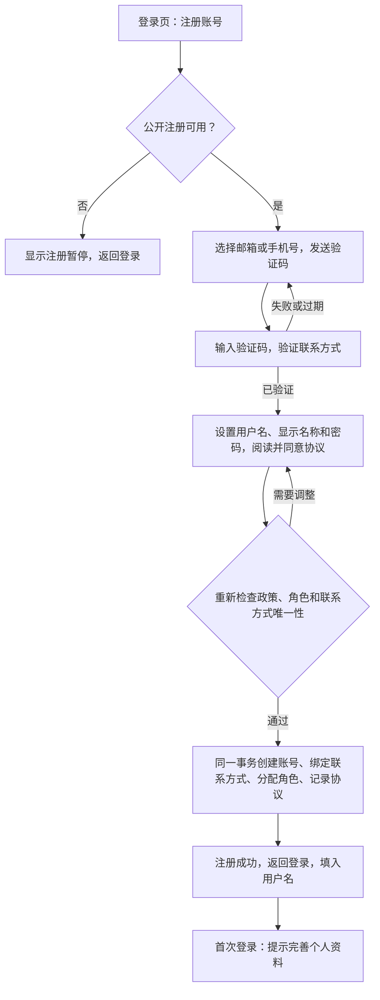

# 公开注册与默认注册角色设计

状态：正在实施，默认不启用。本文定义产品规则；字段级交换结构见[注册与验证码登录接口契约](registration-auth-contracts.md)，实现及验收须另行取得证据。

P04 注册专属流程、配置和事务以本文为事实源；注册必须遵守[角色、认证与账号安全统一设计](role-authentication.md)中的有效角色认证策略、首次 MFA 受限绑定与 CAPTCHA 要求。跨功能工作包、依赖和验收分工见[角色认证与账号安全实施计划](role-authentication-plan.md)。

目标：普通用户可以自行验证联系方式、创建账号，并获得管理员指定的普通角色。注册、验证码投递和角色授权复用现有平台边界；不把管理员创建用户接口开放给匿名调用。

## 1. 产品流程

登录页增加“注册账号”，进入 `/user/register`，沿用登录页品牌、主题、语言和 Ant Design 表单。独立页面方便链接、刷新和移动端使用，不把整个注册流程塞进登录页抽屉。

采用“验证联系方式 → 设置账号 → 注册成功”三个状态：

首版设计支持邮箱和手机号两种注册方式，任选一种，不强制同时提交两个联系方式。管理员可以只开放邮箱、只开放手机，或同时开放两种方式。每种方式必须验证成功，不能提供“无需验证”选项。

手机注册的启用前提包含**手机验证码找回密码**。当前系统只有已验证邮箱找回密码，因此这项是手机注册的配套实施工作，不能拿已有手机绑定当作手机找回已完成。可以先交付邮箱注册，再在手机找回完成后开放手机注册。

注册分配默认角色后，首次登录仍走统一认证状态机。若全局或该真实角色要求 MFA，主凭据通过后进入首次绑定受限状态；验证器绑定并确认前不能建立完整后台会话。这次强制绑定只满足当前认证要求，不记录为账号本人自愿启用 MFA（`SELF_ENABLED`）。注册的发送、验证和创建动作按统一 CAPTCHA 策略执行；注册 OTP 证明、CAPTCHA 证明和 MFA 验证用途彼此独立，细节以[统一设计](role-authentication.md)为准。微信 `LOGIN`、已注册账号附加绑定 `BIND` 与注册期间的可选附加绑定 `REGISTRATION` 是不同用途。未绑定微信进入注册后，若用户主动选择同时绑定，必须新发 `REGISTRATION` 扫码，不能复用此前 `LOGIN` 证明；该附加绑定过期或身份已占用只报告绑定失败原因，不阻止注册完成。微信绑定始终可选，不能替代联系方式注册证明或 CAPTCHA，不能绕过注册流程。

公开注册开关默认关闭。升级部署不自动开放入口；管理员保存有效配置后才能开启。关闭后，已注册账号继续正常登录，尚未完成的注册立即停止创建账号。

### 注册页面

| 状态 | 页面字段与操作 | 行为 |
|---|---|---|
| 验证联系方式 | 邮箱/手机切换、联系方式、发送验证码、验证码、下一步、返回登录 | 只显示管理员开放且配置可用的方式；手机输入带国家码，服务端规范化为 E.164 |
| 设置账号 | 已验证联系方式摘要、用户名、显示名称、密码、确认密码、协议勾选、创建账号 | 联系方式不能直接编辑，修改时回到验证步骤并废弃原证明；角色和组织不出现在注册表单 |
| 完成 | 成功提示、用户名、去登录 | 不自动建立登录会话；点击后登录页填入用户名，不传递密码 |

用户名沿用现有账号规则：3–100 个字符，首位为英文字母或数字，其余允许字母、数字、下划线、短横线和点。保持现有大小写与登录查询语义，不能在本次改动中静默重写旧用户名。系统保留名称按大小写不敏感检查，数据库唯一约束负责最终并发裁决。

显示名称使用现有 200 字符上限。密码复用 `SecurityPolicyPort`、`PasswordContract` 和 `NewPasswordFields`，新摘要通过当前 `PasswordEncoder` 写入 Argon2id；确认密码只用于客户端比对。

验证码统一展示为六位数字，允许粘贴和前导零；使用单个有明确标签的输入框，支持 `autocomplete="one-time-code"`，不引入六个难以粘贴/键盘操作的独立输入框。现有邮箱绑定使用长随机令牌，注册邮件采用新的六位注册验证码，不能直接把邮箱绑定令牌组件改短。

发送成功文案为“验证码已提交发送，请查收”。队列返回 202 表示入队，不表示外部收件成功。显示实际冷却倒计时，429 使用服务端 `Retry-After`；切换联系方式不会重置服务端配额。

密码和验证码不进入 localStorage、URL或日志。离开、刷新、成功或验证失效时清空敏感输入；可通过服务端注册状态恢复当前已验证联系方式摘要，但不能恢复密码。

首次登录继续复用现有资料字段与完成度提示。注册只要求最少账号字段，不把出生日期、真实姓名、头像和所有动态字段一并设成注册门槛。本方案不新增未实现的全局资料强制拦截；后续业务可以自行要求必要资料。

### 协议

用户协议与隐私说明在同页预览，关闭预览保留非敏感表单输入。勾选框默认不选中；最终提交携带用户实际看到的协议版本。

开启公开注册要求两份协议均有内容。创建时检查协议版本，更新后返回 `agreementChanged`，重新显示当前文本并要求再次勾选，不静默替用户接受新版本。

记录账号、协议版本、两份文本摘要、接受时间和请求关联号；协议文本保留不可变版本快照。这里定义的是产品记录机制，不替管理员撰写或确认协议内容。

## 2. 管理员配置与默认角色

在 `/dashboard/security` 所属“认证与安全”新增“公开注册”页签，对应 `/dashboard/registration`。采用当前 `RouteTabs` 与设置表单，不增加新的顶级菜单。

| 配置 | 设计 |
|---|---|
| 开放公开注册 | 开关，默认关闭 |
| 注册验证方式 | 邮箱、手机，至少选一种；选择项不等于实际可用性 |
| 默认注册角色 | 单选已启用、`SELF` 范围且权限适合公开注册的角色；注册开放时必填 |
| 密码与验证码策略 | 展示当前安全策略摘要和跳转链接；不在注册设置复制一套策略 |
| 通道状态 | 展示 SMTP/短信配置是否就绪；手机方式还检查手机找回功能是否已实现且可用 |
| 协议状态 | 显示当前协议版本及是否完整，链接到协议设置 |
| 修改原因 | 必填，复用统一版本冲突和审计反馈 |

角色管理列表中为当前选中角色显示“默认注册角色”标记；编辑入口跳转到注册设置。默认角色只有一个事实源，不在两个页面分别存储。

可新增内置普通角色 `registered-user`（显示名称“注册用户”），`SELF` 范围、无管理权限。拟议初始文件额度为 100 MiB / 100 个文件，管理员可在角色编辑中调整；此额度是设计默认值，不代表当前系统已有此配置，也不改动其他角色或现有用户的配额。

账号个人资料、个人文件、个人通知和会话继续使用账号级授权。可按需给默认角色授予工单读取/创建权限；插件停用时入口随模块状态隐藏。不因为注册而开启反馈插件，也不把当前依赖 `platform:settings:read` 的 AI 管理入口授予普通用户。

### 角色准入规则

- 默认角色必须启用、非管理员角色，数据范围只能为 `SELF`。
- 权限采取显式公开注册准入清单。当前允许工单本人读取/创建，不能仅按 `:read`/`:write` 后缀判断；用户、角色、组织、配置、模块、全局文件、通知管理、审计及工单管理均不准入。
- 未来业务权限必须显式声明适用于公开注册，并由宿主验证。未知插件权限默认不能进入注册角色。
- 客户端提交的 `roleId`、`authorities`、`enabled`、`organizationIds`、配额覆盖值等字段一律拒绝，不能从请求中选择角色。
- 修改注册配置要求**全局** `platform:settings:update` 和 `platform:roles:update`；读取配置要求全局设置读取，读取候选角色还要求全局角色读取。
- 默认角色被引用时，删除、停用、扩大数据范围或加入不准入权限应返回 `registrationRoleInUse`，提示先切换/解除默认角色。权限写入的所有路径均执行此保护。
- 注册成功时按提交时的当前配置赋予角色；发送验证码时的角色快照不构成授权。

切换默认角色只影响随后注册的新账号，不批量改动已注册账号。普通角色的正常权限修改仍沿用既有实时授权语义，因此后台应展示受影响账号数；不把“默认角色切换”和“更新这个角色的已有成员权限”混为一项操作。

## 3. 可用性与边界

公开可用性由“注册开关、所选方式、通道配置、角色、协议、维护状态”共同决定。只返回浏览器需要的注册方式、密码规则摘要、验证码时间参数及协议版本，不返回默认角色 ID、完整权限、密钥、验证码、内部错误或账号数量。

邮箱方式要求 SMTP 配置及密钥可用；手机方式要求短信配置、模板/密钥与手机找回功能就绪。两种方式同时开放时，某一方式失效可以只移除该方式；仅开放的一种方式失效时暂停注册，不能降级为不验证。

注册在维护期间暂停，不通过尚未分配角色的匿名用户套用维护白名单。GET 状态可用，挑战、验证和创建分别在服务端复查，不能只依赖入口隐藏。

配置就绪检查不发测试邮件/短信，不承诺网络一定送达。发送结果由现有 worker 处理。

## 4. 接口契约（拟议）

所有写请求保留 CSRF。匿名允许规则必须精确到 HTTP 方法和路径，继续默认拒绝其他接口，新增端点纳入路由权限覆盖测试。

| 方法与路径 | 输入/输出 | 权限与结果 |
|---|---|---|
| `GET /api/auth/registration/config` | `available`、可用 `channels`、密码规则、验证码策略、`policyVersion`、协议版本与文本摘要/文本 | 可匿名，只读；暂停时只给出公开原因码 |
| `POST /api/auth/registration/challenges` | `channel`、`contact`、`locale` → `challengeId`、有效期、下一次可发送时间 | 匿名＋CSRF；202 入队，429 限流，503 注册/通道不可用；最大 4 KiB |
| `POST /api/auth/registration/challenges/verify` | `challengeId`、`code` → `proofId`、证明有效期 | 匿名＋CSRF；与当前匿名注册会话绑定；错误证明在计数提交后转为 400；最大 2 KiB |
| `GET /api/auth/registration/state` | 当前会话有效挑战/证明的状态、脱敏联系方式、有效期 | 匿名，只返回本会话状态，不返回验证码；用于刷新恢复 |
| `POST /api/auth/registration/complete` | `proofId`、`username`、`displayName`、`password`、`policyVersion`、`agreementVersion`、`acceptAgreements`、`requestId`、可选附加资料与独立微信注册绑定证明 | 匿名＋CSRF；201 返回注册回执、用户名和固定站内登录路径；最大 128 KiB；公开 custom 字段最多 20 个 |
| `GET /api/platform/settings/registration` | 版本化管理配置、就绪检查 | 全局设置读取；角色详情另校验角色读取 |
| `GET /api/platform/settings/registration/roles` | 分页候选角色及准入/不可选原因 | 全局设置读取＋角色读取，不向匿名公开 |
| `PUT /api/platform/settings/registration` | `version`、`enabled`、`channels`、`defaultRoleId`、`changeReason` | 全局设置写＋角色写；版本冲突 409；最大 8 KiB |

`proofId` 是已验证挑战的标识，不是单独可转让的凭证。服务端要求挑战属于同一匿名注册会话、状态为 VERIFIED、没有过期，才能使用。不会只凭 UUID 就允许创建账号。

默认不提供匿名联系方式占用查询接口。给格式正确的联系方式请求验证码时，已占用与未占用保持相同响应形态；可向两类联系方式都发送受限的注册验证码。证明持有人控制该联系方式后，才提示“该联系方式已有账号，请登录或找回密码”。挑战不修改原账号的联系方式或密码。

用户名占用也在联系方式证明有效之后检查；最终仍由数据库唯一约束兜底。前端可进行格式检查，不能把实时可用提示当作成功保证。

公开密码规则只返回用户设置密码需要的字段，不将现有管理员安全策略接口整体开放。新增 `/user/register` 路由以及统一错误消息的八语言翻译。

手机找回沿用“请求 → 确认 → 撤销既有会话”的恢复模型，但使用独立恢复用途验证码；注册验证码不得用于登录、绑定或找回。

## 5. 存储与事务

实施时以迁移目录中的实际最高版本为准追加迁移，不改写任何已发布迁移，也不重建主库。本文不创建迁移或种子数据。

### 拟议数据

| 表/改动 | 职责 |
|---|---|
| `platform_registration_policy` | 单例政策：开关、方式、默认角色外键、版本、修改人/时间；初始关闭、无默认角色 |
| `platform_registration_challenge` | 挑战 UUID、匿名会话绑定摘要、用途/方式、加密联系方式、联系方式 HMAC 指纹、验证码 HMAC、状态、有效期、失败次数、已创建账号与幂等回执 |
| 注册限流桶 | 用途隔离的来源/联系方式/会话计数；不把明文联系方式做日志键，独立提交并有保留清理 |
| `platform_agreement_document` | 按协议设置版本保存不可变的两份协议文本与摘要，版本唯一 |
| `platform_account_agreement_acceptance` | 账号外键、协议快照外键、接受时间、请求关联号；一个注册只生成一份接受记录 |
| 现有账号、角色关联、邮箱/手机表 | 最终成功时写入正式账号、默认角色及已验证联系方式；沿用既有大小写邮箱唯一性和 E.164 手机唯一性 |

注册设置使用独立、带角色外键的政策表，理由是角色引用保护和注册完成需要在同一事务锁定并校验。复用设置的版本、审计和表单约定，但不把强关联角色 ID 再复制到通用 JSON 设置中，避免两个事实源。

状态机：`PENDING → VERIFIED → CONSUMED`；过期为 `EXPIRED`，达到失败上限为 `LOCKED`，更换联系方式/新挑战为 `SUPERSEDED`。同一会话、方式和联系方式的新发送替换旧挑战。限流按联系方式指纹执行，开新会话不能绕过冷却或每日配额。

验证码使用密码学随机六位数。HMAC 输入包含 `purpose=PUBLIC_REGISTRATION`、挑战 ID、会话绑定、联系方式指纹和验证码，持久化摘要携带密钥版本；部署密钥由现有密钥机制管理。不会使用可离线穷举的裸 SHA-256 六位验证码摘要，也不会把已登录账号绑定用途的 `PhoneVerificationCode` 原样挪到匿名注册。

挑战创建与加密邮件/短信队列入队同事务；数据库只保存加密联系方式和验证码摘要。验证成功清除验证码摘要，原有效期约束保留，已验证证明额外最长保留 5 分钟。失败次数/请求配额先提交，再转换 HTTP 错误，避免回滚造成无限尝试。

### 创建事务

1. 用独立限流事务限制来源、会话和联系方式；使用现有 `ClientAddressResolver` 的可信代理规则，不任意接受转发来源头。校验载荷、用户名、密码策略及当前内容策略，并先以只读查询检查证明属于本会话、有效且未消费，避免无效匿名请求直接触发昂贵的密码编码。
2. 在短事务外计算密码摘要，再按统一锁顺序开始写事务；重新读取权威政策、角色与安全快照，密码策略发生变化时重新校验，不能仅使用前端摘要。
3. 重新检查注册开放、维护状态、政策版本、角色准入、证明会话/用途/有效期和协议版本。
4. 创建账号，写入且标记选定联系方式已验证；写入默认角色关联，不自动加入组织。
5. 写入协议接受记录、来源为 PUBLIC_REGISTRATION 的审计事件及完成回执；消费证明，与以上内容一并提交。
6. 事务提交后返回成功，不自动登录。任一业务写入失败时，没有残留账号、角色关联或已消费证明。

注册创建及相关多类写操作遵守统一认证设计的锁顺序：必要共享管理锁 → 全局认证政策 → 注册政策（涉及注册时）→ 按 ID 排序的相关角色 → 协议/安全设置权威快照 → 涉及的既有账号 → 挑战/绑定 → 新账号写入。注册创建通常只写入新账号；既有账号步骤仅在该事务确实涉及已有账号时适用。最终校验使用权威设置快照并持有适当共享锁，不能依赖短 TTL 缓存；协议发布与注册提交需要明确的串行顺序。涉及默认角色的删除、停用和权限更新也遵守兼容前缀，角色授权的所有写路径锁定同一角色行，避免注册检查与权限更新竞态。这是供未来实现遵守的设计约束，不表示现有锁代码已经按此调整。

角色、联系方式、用户名及幂等唯一约束是最后防线；不能只做 SELECT 检查再 INSERT。跨邮箱/手机绑定的唯一冲突返回受控错误，完整创建事务回滚。

敏感词模块不能让匿名调用绕过新端点：创建前依据**当前默认注册角色**的内容策略检查用户名/显示名称。密码、验证码、邮箱/手机作为专用凭证字段不按普通业务文本扫描；通过用途明确的策略 port 实现，既不开放匿名词库，也不临时伪造一个已登录用户。默认角色版本变化后重新检查。

### 重试与幂等

`requestId` 为每次“创建账号”操作的随机 UUID，同一匿名会话和证明内唯一。保存请求内容的用途隔离 HMAC 指纹以及非敏感回执，不保存明文密码。

相同请求重放返回原回执，不创建第二个账号；同一个 requestId 携带不同内容返回 409。成功响应丢失时，本会话可以查询状态并恢复成功页面。旧挑战不能跨会话重放；只有其消费生成的原注册回执可幂等读取。

未完成挑战按短保留期清理，完成回执拟保留 24 小时后删除联系方式密文/摘要；账号审计和协议接受证据按各自保留策略处理。清理任务有界分页，不删除现有账号或文件。

## 6. 实施边界与复用

工作包、跨功能依赖和统一验收责任见[角色认证与账号安全实施计划](role-authentication-plan.md)；本节只界定 P04 的实现归属。认证策略、角色 MFA 与 CAPTCHA 行为以[统一设计](role-authentication.md)为唯一事实源，不在注册配置中复制一套策略。

| 归属 | 新增/改动 |
|---|---|
| `identity` | `PublicRegistrationController/Service`、挑战存储、验证码与限流、会话绑定、注册响应 DTO、手机找回配套 |
| `settings` | 注册配置管理、公开安全摘要/协议快照读取；通过 identity API port 提供策略，不让 identity 导入 settings 实现 |
| `roles` | 默认角色候选、准入检查与引用保护，提供 `RegistrationRolePort` 实现；不把 RoleRepository 直接注入 identity |
| `users` | 可信 `AccountProvisioningPort` 实现：只创建账号并返回稳定 ID；验证邮箱/手机由 identity 写入，初始角色由 roles port 关联，identity 在同一事务编排；管理员 UserService 保留原鉴权 |
| `common` / 既有平台 ports | 复用审计、内容策略、邮件/SMS 入队；只放必要契约，不建立无鉴权的通用创建用户入口 |
| 前端 `platform/auth` | 注册页面、状态及密码/协议表单，复用 API 客户端、PlatformForm、AsyncButton、useSubmitAction |
| 前端 `features/settings` | 注册设置页及 RouteTabs 注册；角色页显示默认角色标记 |

身份模块使用自己的 orchestrator，通过 ports 调用，避免 identity↔roles/settings/users 循环依赖。政策/角色保护等跨模块契约放在 common 的窄 port 中，settings 和 users 的现有 identity API 依赖可沿用；当前 roles 只允许依赖 files，不能直接新增 roles→identity 引用而假定护栏已经允许。所有 port 实现加入宿主事务，不使用独立提交造成半成品账号；独立提交只用于限流/失败计数。新增依赖必须登记并通过 ArchUnit/模块所有权检查。Controller 使用 `identity/api` 的 Response DTO，不直接返回 Store 内部记录。

这一项仍属于平台身份能力，不依赖赛事、报名、支付或其他业务模块。P06 验证码登录、P07 微信、P08 MFA、P09 CAPTCHA、邀请激活仍各有独立工作范围；本设计没有将它们标记为已有。匿名注册增加来源/会话/联系方式限制，联系方式验证码不是 CAPTCHA。

## 7. 异常处理

| 情况 | 用户结果 | 数据结果 |
|---|---|---|
| 注册关闭/维护中 | 注册暂停，保留返回登录入口 | 不发送、不创建账号 |
| 通道配置不可用 | 当前方式暂不可用，允许选择另一个已开放方式 | 不留下未入队的有效挑战 |
| 入队成功但实际发送失败 | 提示重发/更换方式，遵守冷却 | 保留失败投递记录，不伪报验证码已送达 |
| 验证码错误/过期/超限 | 明确提示重试或重新发送 | 失败计数持久化，旧证明不能创建账号 |
| 协议或注册政策更新 | 刷新当前政策，重新确认协议后提交 | 不静默接受变化、不创建半成品账号 |
| 用户名占用 | 在已验证步骤提示修改用户名 | 证明有效期内可以重试，无账号残留 |
| 联系方式已属于其他账号 | 验证持有人后提示登录/找回密码 | 不重绑或覆盖旧账号 |
| 默认角色非法或发生并发修改 | 暂停创建，管理员看到具体原因 | 不退回无角色账号，也不使用旧角色快照 |
| 重复点击/响应丢失 | 提交期间禁用按钮，重试恢复原回执 | 最多一个账号、一个角色关联和一次协议记录 |

## 8. 实施次序与验收

下列步骤只描述 P04 专属次序；完整工作包依赖与跨功能验收职责见[实施计划](role-authentication-plan.md)。

1. 政策/角色准入与版本化管理，追加迁移、普通角色和默认关闭状态；先形成可管理配置。
2. 邮箱匿名挑战、状态恢复、验证与原子创建，完成用户名/联系方式并发唯一性、协议快照和重试回执。
3. 注册页面与后台页签、八语言、普通账号首次登录及资料提示；同时核对内容策略和反馈停用状态。
4. 手机注册挑战和手机找回；两项一起验收后才开放手机方式。
5. 独立测试账号、回环邮件/短信模拟及浏览器验收，清理自建挑战和测试账号；不修改管理员密码或既有业务数据。

必须验证的结果：

- 开关关闭、未配置通道、维护期间、协议为空、角色非法时，匿名请求不能创建账号。
- 注册完成最多获得指定的普通 SELF 角色；篡改角色、权限、组织、配额或 enabled 字段被拒绝。
- CSRF、来源限制、联系方式冷却/日限额、错误码次数、过期、跨会话、重放及密码/验证码用途隔离有效。
- 两个会话并发注册同一联系方式、同用户名或同时消费证明，只产生一个合法账号；失败没有半成品记录。
- 默认角色并发修改/停用/删除及协议更新不会产生越权授权或自动接受新协议。
- 注册入队失败、审计失败、协议写入失败或默认角色关联失败可以验证完整回滚。
- 手机注册账号可使用已验证手机找回密码，恢复成功撤销已有会话；邮箱方式复用现有恢复能力。
- 真实页面完成发送、校验、创建、返回登录、新账号登录、刷新后身份/角色/联系方式/协议记录持久化；密码不进入浏览器存储。
- 桌面、390px 移动端、键盘/粘贴、主题及八语言可用，提交失败可重试，协议预览保留非敏感输入。
- 服务端/数据库测试、类型检查、生产构建、健康、浏览器和实际外部送达分别记录；回环模拟通过不等于生产邮箱/手机收件成功。

## 9. 当前依据

- `apps/web/src/platform/auth/login-page.tsx`：登录、Passkey 和找回密码入口，暂无公开注册。
- `backend/src/main/java/com/lumira/platform/users/UserService.java`：管理员创建用户要求全局写权限，不能匿名复用该 HTTP 入口。
- `backend/src/main/java/com/lumira/platform/roles/RoleService.java`：角色授权、数据范围、文件配额和已有管理员保护。
- `backend/src/main/java/com/lumira/platform/identity/AccountEmailService.java`、`AccountPhoneService.java`：已有登录账号绑定服务，不能直接当匿名注册。
- `backend/src/main/java/com/lumira/platform/identity/ProfileCompletionService.java`：现有资料完成度计算。
- `backend/src/main/java/com/lumira/platform/settings/AgreementController.java`：现有协议版本管理；公开响应目前只返回内容，注册需要补版本契约。
- `docs/code-conventions.md`、`docs/account-email.md`、`docs/account-phone.md`、`docs/password-recovery.md`：复用、事务、凭据和验证边界。
