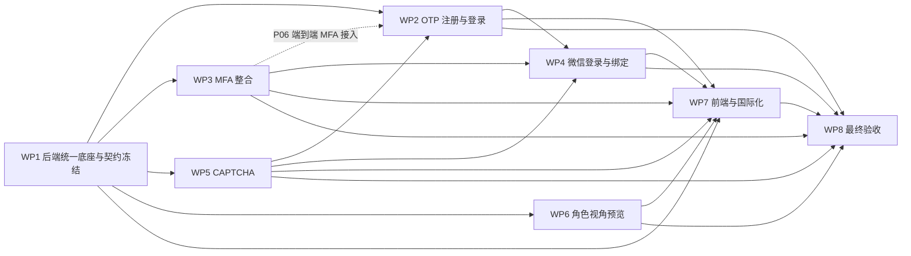

# 角色认证与账号安全实施计划

状态：统一实现与隔离环境核心验收已完成；外部供应商联调、凭据管理的完整人工界面操作及生产容灾分别待验。本文覆盖 P04、P06–P10，以及自定义字段位置、全局样式与性能可靠性约束；下文维护工作包职责和独立证据要求，外部联调及生产容灾不从本地检查推导完成。

## 目标与唯一事实源

- [角色、认证与账号安全统一设计](role-authentication.md) 是认证策略、角色策略合并、登录状态机、MFA、微信、CAPTCHA、角色预览、接口边界与锁顺序的唯一设计事实源。
- [认证与角色可靠性验收](authentication-reliability.md) 定义共享状态、凭据修订、锁与批量查询、插件多实例运行及故障证据要求。
- [验证器替换与恢复契约](mfa-recovery-contracts.md) 补充原子替换、恢复通知/票据、受限重新绑定、非密码再次验证与运维恢复接口。
- [公开注册与默认注册角色设计](public-registration.md) 是 P04 注册体验、注册配置、数据事务与注册专属验收的唯一事实源；注册必须遵守统一认证设计里的首次 MFA 受限绑定和 CAPTCHA 要求。
- 本文只维护工作包、依赖关系、职责、交付物和验收证据，不再复制上述设计中的策略细节。策略变化先改相应事实源，再更新受影响工作包。

主智能体负责需求分析、边界协调、任务拆分、接口与数据契约冻结、委派、变更审阅和最终验收；子智能体承担各工作包的业务编码、聚焦测试与实现说明。各包不得自行改变已冻结的跨包契约。没有依据的工期不作估算；下列波次只表达依赖关系。

## 交付约束

### 自定义字段与页面位置

后台资料字段管理同时配置字段定义与白名单位置，首批宿主为个人资料、管理员用户编辑及公开注册附加资料区。位置包含宿主页面、页签、分组与顺序；同一字段沿用稳定 key 和单一账号资料值。已有字段配置保持旧布局默认值。公开注册只读取显式准入的 custom 字段，不公开管理 schema 或完整内部字典，不注入密码、角色、联系方式、MFA 等身份字段。注册附加资料保持可选，不改动最少身份验证门槛。

宿主位置由源码注册表约束，不允许任意路由、HTML 或可执行表达式。后端验证位置、类型与 schema 版本；必填字段必须存在可填写的位置。隐藏或不在当前宿主展示的字段不产生无从完成的表单拦截，也不允许以该规则删除已有资料值。具体结构及兼容契约见后续自定义字段实现说明。

### 全局一致的样式

新增页面复用 Ant Design 6 全局主题 token、PlatformForm、FormDrawer、RouteTabs、ResourceTable、提交生命周期与 API 错误处理。字段渲染共用组件，个人资料/用户编辑/注册保持标签、控件、帮助与校验信息一致。桌面与 390px、明暗主题、八语言、键盘/粘贴均为验收范围；不另建认证专用主题或独立按钮/表格体系。

### 性能、可靠性与可用性

- 认证挑战、OAuth state、一次性证明、角色要求与会话状态在共享持久存储管理，不依赖单进程内存才能续接；多实例必须共享同一兼容数据库与密钥环。
- 成功证明只能消费一次，失败计数不能回滚抹除；策略变更和凭据撤销对既有会话生效。外部供应商超时、投递失败和提供方卸载不得产生完整会话或半成品账号。
- 外部网络交换不持有数据库长锁；列表分页，挑战清理有界批次，资料字段/位置/字典大小有上限；请求路径禁止无界清表和逐字段 N+1 查询。
- 局部性能检查记录并发数、持续时间、p50/p95/p99、错误/限流比例和数据库查询计划；同环境对比新增热路径，发现明显退化必须修复。密码编码与外部供应商延迟分别计量，不用静态健康接口吞吐代表登录容量。
- 多实例共享状态、节点切换、数据库/供应商故障、超时取消、重启后挑战续接、队列租约和恢复演练分别提供证据。生产高可用还需要实际部署、负载均衡和数据库容灾验证；本地测试不能据此标记生产高可用已完成。

局部检查由编码子智能体完成，项目负责人独立检查集成、真实浏览器和持久化；未满足证据的项保留为待验收，不用“已保证高可用”代替测试结果。

当前 `SecondFactorLoginService`、`SecondFactorController`、`SecondFactorProvider` 及 `plugins/mfa` 已整合统一角色强制、首次受限绑定和恢复闭环。核心HTTP/数据库流程已有独立验收；工作包中的外部渠道及完整人工界面验收仍单列。其余已存在的凭据绑定能力也不等于 OTP 登录、公开注册或微信登录。

## 依赖波次

**波次 0：底座和契约冻结。** WP1 先明确有效认证策略、状态机、挑战用途、模块 ports、API/错误状态、策略修订和跨表锁顺序。未冻结的契约不能作为并行编码的假设。

**波次 1：独立后端能力。** WP2、WP3、WP5 和 WP6 在 WP1 契约冻结后可并行编码；WP2 对 MFA SPI 的端到端接入等 WP3 可用后完成，CAPTCHA 的实际动作接入与相应功能一起完成。WP7 可先做不依赖接口细节的页面骨架，接口联调须等各包 API 契约稳定。

**波次 2：微信和界面整合。** WP4 使用 WP1 的统一认证入口、WP2 的 P04 注册去向、WP3 的 MFA 闭环以及 WP5 已冻结的 CAPTCHA 动作契约。WP7 完成全部页面、错误态、八语言和跨包联调。

**波次 3：独立最终验收。** WP8 汇总服务端、数据库、前端构建、健康状态、浏览器交互与外部服务证据。源码存在、模拟适配器通过、HTTP 200 或单项测试都不能替代完整验收。

## 工作包

### WP1：后端统一认证底座

**范围与责任：** 建立全局与角色有效认证策略、策略修订、窄模块 ports、统一预认证/最终认证服务、受限状态与再次验证契约；明确 `SELF_ENABLED` 与 `RECOVERY_PENDING` 是账号持久事实，全局/角色强制要求按当前策略动态派生。兼容现有密码、Passkey 和 second-factor 路径。冻结所有后续包使用的 API、错误码、挑战状态、purpose/action 命名、事务边界、迁移规则和锁顺序。不得另建第二套待 MFA 会话或让功能包直接互相依赖实现模块。

**依赖：** 无；此包先完成契约评审，再向其他包开放。

**交付物：** 后端策略与统一认证编排；必要的追加迁移；跨模块 API/port、状态和权限矩阵；迁移升级及并发/错误路径测试。迁移始终追加到实施时迁移目录的实际最高版本之后，不改写已发布迁移。

**验收证据：** 后端测试证明真实多角色策略顺序无关、登录方式取交集、MFA/CAPTCHA 取最严要求、冲突和空方式拒绝、未完成认证无法访问业务 API；策略修订和并发消费有数据库证据；依赖边界检查通过；契约文档与实际端点、错误状态一致。

### WP2：OTP 注册与登录（P04、P06）

**范围与责任：** 实现 P04 公开注册、默认注册角色、邮箱注册，以及在手机找回配套就绪后开放手机注册；实现 P06 邮箱/短信验证码作为已有账号的主登录方式。注册码、登录码、已登录绑定码、找回码和恢复码必须按用途、会话、账号与动作隔离；OTP 登录完成主验证后进入 WP1 统一 MFA/CAPTCHA 状态机。注册成功不自动创建完整登录会话。

注册被分配的真实角色要求 MFA 时，首次登录须进入统一的 `ENROLLMENT_REQUIRED` 受限流程；完成并确认 MFA 前不得获得完整会话或普通后台访问。注册发送、验证和创建按统一认证设计执行 CAPTCHA；联系方式 OTP 证明不能替代 CAPTCHA proof。微信 `LOGIN`、已注册账号附加绑定 `BIND` 与注册期间的可选附加绑定 `REGISTRATION` 严格分开。未绑定微信的用户进入注册后若主动选择同时绑定，必须新发 `REGISTRATION` 扫码，不能消费此前 `LOGIN` 证明；附加绑定过期或身份被占用时注册照常完成，并返回绑定失败原因。微信绑定不能替代注册联系方式证明或 CAPTCHA，也不能成为注册前置条件或强制绑定项。

**依赖：** WP1 认证与 MFA SPI、WP5 挑战动作契约先冻结。OTP 核心与 WP3 可并行实现；P06 端到端 MFA 接入和验收依赖 WP3 提供方可用。OTP 注册正文和专属事务仍以 [公开注册设计](public-registration.md) 为准。

**交付物：** 服务端注册与登录挑战/API、用途隔离和投递编排、配置及默认角色保护、必要迁移、注册/登录页面接口说明与后端回归测试；手机注册只能在手机找回可用的前置验收通过后开放。

**验收证据：** 注册关闭、配置不完整、错误角色、维护状态或无效证明下不能建号；篡改角色/权限/组织/配额无效；幂等和联系方式/用户名并发唯一性成立；登录不枚举账号；OTP 跨用途、跨会话、重放和过期均失败；数据库证明完整回滚；浏览器真实完成邮箱注册、验证码登录、新会话 MFA 门槛与刷新恢复。真实投递和回环模拟分别记录。

### WP3：MFA 整合（P08）

**范围与责任：** 整合现有宿主 second-factor 服务与 `plugins/mfa` 提供方，实现统一策略强制、首次受限绑定、登录挑战、TOTP 重放防护、恢复码、验证器更换/解绑、本人恢复、管理员重置和受控运维恢复。角色强制首次绑定不设置或清除 `SELF_ENABLED`；角色停用/移除只移除该角色的派生要求，其他有效角色要求、本人持久要求及恢复状态仍生效。兼容所有主登录方式；角色或全局要求不能被解除、插件卸载、找回密码、Passkey、微信或 OTP 主登录绕过。

**依赖：** WP1 认证状态、再次验证、提供方与生命周期契约先冻结。WP2/WP4 的主登录流程通过该契约接入；MFA 提供方可与这些登录流程并行实现。

**交付物：** 宿主 MFA 状态机和插件适配；账号、角色与运维管理 API；恢复待办及审计；必要的插件或宿主追加迁移；覆盖重放、解绑、恢复和停用护栏的测试。

**验收证据：** TOTP 测试向量与一次性使用测试通过；每个主登录入口在强制策略下要求 MFA；首次绑定期业务 API 被拒绝且不会误设 `SELF_ENABLED`；恢复码只消费一次；重置与找回不能取消角色要求；停用/移除角色后重新计算其余来源要求；必要提供方未就绪时不能保存强制策略或降级登录；使用真实浏览器完成绑定、验证、更换和恢复并检查刷新/会话撤销。

### WP4：微信登录与身份绑定（P07）

**范围与责任：** 接入微信开放平台网站应用扫码流程、服务端 state/code 交换、已绑定账号主登录、未绑定身份转 P04 注册、账号安全页可选绑定/解除，并调用统一 MFA/CAPTCHA 编排。`LOGIN`、已注册账号的 `BIND`、注册过程中的 `REGISTRATION` 三种用途严格隔离。未绑定微信进入注册后，如用户主动选择同时绑定，必须新发 `REGISTRATION` 扫码，不能复用原 `LOGIN` 证明；附加绑定过期或身份被占用时保留注册成功并返回绑定失败原因。不自动关联账号、不自动创建账号，不强制所有注册用户绑定微信。

**依赖：** WP1 统一主凭据与策略入口、WP2 的注册跳转、WP3 MFA、WP5 CAPTCHA 契约。真实联调还依赖已批准的网站应用、AppID/密钥与回调域配置。

**交付物：** OAuth 尝试/回调/身份绑定 API 和数据约束、加密配置与密钥轮换边界、应用设置界面、取消/失败/身份冲突处理及模拟提供方测试。

**验收证据：** state/code 错会话、错用途、过期、重放和并发回调均不能完成对应动作；`LOGIN` proof 不能完成 `BIND` 或 `REGISTRATION`；未绑定身份安全转注册；任何登录成功后都重新计算角色要求并进入 MFA；注册期间的可选绑定过期或身份被占用不回滚账号创建并返回明确失败原因；附加绑定不能绕过注册或验证码/CAPTCHA；模拟测试与真实网站应用授权分别留证。

### WP5：CAPTCHA（P09）

**范围与责任：** 实现可注册的图形/滑块挑战提供方、全局按动作策略、角色 `ALWAYS` 追加要求、风险触发、可访问替代和供应商故障封闭处理；挑战 proof 短期、单动作、单会话、一次性消费。恢复请求只执行全局 CAPTCHA；完成恢复联系方式证明后，在密码修改确认前再评估角色 CAPTCHA。不得信任客户端 `passed=true`，不得把 CAPTCHA 当作邮箱/手机验证或 MFA。

**依赖：** WP1 的认证策略、挑战和 action 契约；分别与 WP2、WP4 在发送/注册/登录/OAuth 等相关动作接线。启用必需策略前，实际提供方与同等级无障碍替代必须就绪。

**交付物：** 提供方契约与适配器、策略管理 API/页面、挑战/核验/消费端点、清理与失败计数路径、访问性与服务故障说明、后端和浏览器测试。

**验收证据：** 伪造、跨动作/会话、过期、重放、错误尝试和提供方故障均不能放行必需动作；键盘与替代挑战可完成；真实浏览器完成受保护注册、登录码或 OAuth 动作；提供方测试与真实服务状态分别记录。

### WP6：角色视角预览（P10）

**范围与责任：** 实现本人已分配角色预览及获准管理员对未分配角色的受限预览。保持真实操作者、身份、会话和认证策略；会话预览状态带 `authorizationContextRevision`，所有业务请求和资源票据都校验该修订，防止退出预览后的旧标签恢复管理员权限。预览权限须受本人权限与目标角色权限共同限制，数据范围取两者可读范围交集；SQL 使用显式授权上下文参数及真实/有效权限双分支。只允许明确声明的无副作用读取，服务端拦截写入、上传、导出、通知已读、工具执行等副作用；过期或授权变化进入阻断状态，不能自动恢复管理员权限。

**依赖：** WP1 的真实认证上下文/请求授权契约，以及权限与数据范围策略；依赖插件安全读取声明及导航/查询端点清单。

**交付物：** 带 `authorizationContextRevision` 的会话预览上下文与权限、请求及资源票据校验、显式 SQL 授权上下文和插件执行机制；授权/审计 API；角色入口和跨标签同步契约；直接 URL/API、只读白名单、过期和撤销测试。

**验收证据：** 浏览器菜单、直接路由、API、SQL 数据范围一致；写入和副作用请求服务端拒绝并留审计；所有业务请求和资源票据拒绝过期 `authorizationContextRevision`；退出后旧标签不能恢复管理员权限；多标签共享状态；角色撤销/预览过期不会恢复完整权限；独立普通测试账号另行证明用户所有权隔离，管理员自身 `SELF` 预览不作替代。

### WP7：前端与国际化

**范围与责任：** 依已冻结 API 接入注册/验证码登录、微信、CAPTCHA、MFA 受限绑定与恢复、角色登录策略编辑、角色视角预览和操作反馈。沿用 Umi Max、Ant Design 6、现有 API/RouteTabs/feature registry 与权限模式；维护八种语言及 Ant Design locale，不暴露未就绪提供方入口，不在浏览器存储密钥、OTP、恢复码或 OAuth code。

**依赖：** WP1 先冻结公共状态、API 与错误语义；各页面联调依赖 WP2–WP6 对应后端契约。可提前搭建静态壳层，但不得臆造后端状态。

**交付物：** 页面、路由、共享认证状态组件、八语言文案、键盘/移动布局、错误和空/受限状态处理，以及端到端联调记录。

**验收证据：** 桌面和 390px 视口完成主要流程；语言切换覆盖表单、错误和状态；粘贴 OTP、键盘挑战和屏幕可读信息可用；刷新仅恢复允许恢复的脱敏状态；认证未完成时页面和 API 均不提供普通权限；主题、CSRF 与错误重试符合现有壳层。

### WP8：最终验收

**范围与责任：** 主智能体逐项对照冻结契约、工作包交付和证据，复核跨功能安全边界，记录已完成、部分完成、阻塞及未验证项。子智能体提供实现说明和原始检查结果，不替主智能体判定总体验收。

**依赖：** WP1–WP7 实现完成、代码评审与各包局部验收结果可复查。

**交付物：** 汇总验收记录、未通过项及责任工作包、待办决策、可复现的构建/迁移/浏览器/外部集成证据链接。不得为追求一次通过而修改管理员密码、真实角色关系、供应商密钥或业务数据。

**验收证据：** 服务端测试与数据库迁移/约束验证、类型检查和生产构建、前后端健康状态、认证与权限负向用例、真实浏览器流程和刷新/持久化行为分别记录；CAPTCHA 提供方、邮件/短信实际送达、微信开放平台真实授权等外部证据与模拟结果分开。只有这些证据覆盖目标包后，主智能体才能把对应包标记为验收完成。

## 完成判定

每个工作包分别记录“已编码、局部检查通过、集成完成、浏览器验收、外部服务验收”的证据，不用源码存在、接口返回 200 或模拟测试推导完整能力。公开注册和外部提供方保留默认关闭状态，直到渠道、默认角色、协议及必要验证条件就绪。MFA不会因升级自动强制现有账号绑定；角色预览按真实权限与目标角色交集读取，拒绝未声明的页面和副作用。

## 当前交付状态

| 工作包 | 实现与本地证据 | 后续独立验收 |
| --- | --- | --- |
| WP1 统一底座 | 策略交集、修订、受限状态、再次验证、共享挑战已接入；真实数据库与完整后端回归通过 | 生产负载与容量 |
| WP2 注册/OTP | 默认角色保护、联系方式证明、幂等及持久化通过；邮箱OTP浏览器登录刷新通过 | 真实邮件/短信收件，浏览器新密码/协议最终提交 |
| WP3 MFA | 强制首次受限绑定、TOTP/恢复、原子替换、实际JAR离线恢复、跨节点与旧会话撤销通过；既有验证器登录与刷新通过 | 新凭据扫描/管理的完整人工界面操作，恢复渠道真实送达 |
| WP4 微信 | 回调、绑定、注册附加身份及统一认证接线，协议/数据库和实际负例通过 | 开放平台真实授权、回调域与设备联调 |
| WP5 CAPTCHA | 后端proof/用途隔离、风险/角色要求、设置与SDK接线，协议故障/数据库/实际负例通过 | 真实主挑战及可访问替代 |
| WP6 角色预览 | 66项实际HTTP、所有者隔离、单次资源票据、过期阻断、只读界面和跨tab退出通过 | 新宿主页面逐个声明与验收后再开放 |
| WP7 前端 | 三字段宿主、统一组件/主题、八语言、类型/质量/生产构建、100主测试和4AI测试通过；桌面及390px抽查 | 外部挑战与人工凭据输入场景 |
| WP8 集成/发布 | V1–39新库和历史前向升级、MFA1.0.5、固定图双节点/故障恢复、本地主预览升级完成 | 实际生产LB、数据库容灾、镜像构建与备份恢复演练 |

临时原始记录存于 `.runtime/role-authentication/acceptance.md`；它区分构建、运行、交互和外部证据。部署固定图的同图滚动/异图排空规则以[插件运行](plugins.md)为准。
