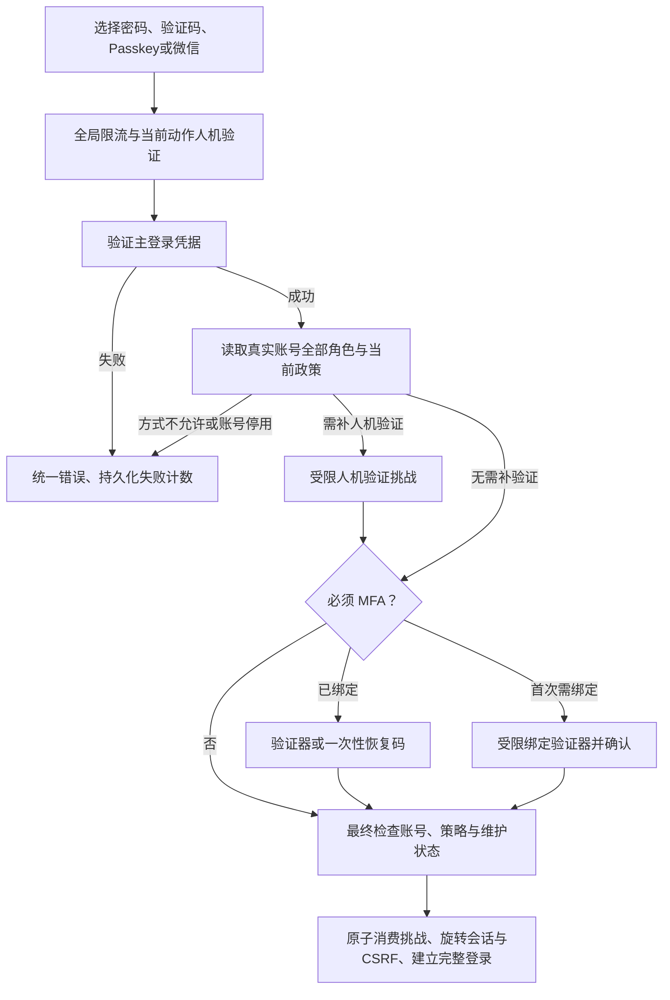

# 角色、认证与账号安全统一设计

状态：统一实现与隔离环境核心验收已完成；外部供应商联调、凭据管理的完整人工界面操作及生产容灾分别待验。本文覆盖 P04、P06–P10，定义统一产品规则；字段级接口以各功能契约为准，工作包及证据要求见[实施计划](role-authentication-plan.md)。源码、数据库迁移、运行构建、浏览器和外部供应商分别取得验收证据后，才能认定对应能力完成。

公开注册与默认角色的创建事务、联系方式验证和协议接受沿用 [公开注册设计](public-registration.md)。本文补齐验证码登录、微信身份、MFA、CAPTCHA 与角色预览，并定义它们如何共同受角色策略约束。

## 1. 功能归属与统一入口

角色决定访问权限、数据范围以及登录必须满足的规则；联系方式、微信身份和验证器属于账号。验证码登录证明联系方式控制权，MFA 增加独立验证，CAPTCHA 控制自动化请求，角色预览用于检查授权结果。六项在产品上统一组织，在存储和验证用途上保持明确边界。

| 入口 | 内容 | 权限 |
|---|---|---|
| 用户管理 → 角色管理 `/dashboard/roles` | 编辑抽屉包含基本信息、权限与数据范围、文件额度及角色认证策略；顶栏提供角色预览入口 | 复用角色读取/写入；认证策略另要求全局设置权限 |
| 用户管理 → 用户详情 | 已绑定方式、MFA 状态、实际生效策略、要求来源；经授权的 MFA 恢复入口 | 全局用户读取；重置另需 MFA 管理权限，不显示密钥 |
| 认证与安全 | 现有安全策略、Passkey；增加公开注册、登录方式、微信、人机验证页签，使用 `AuthenticationSecurityTabs` | 全局设置读取/写入；注册角色配置另外校验角色权限 |
| 个人资料页 → 账号安全 `/dashboard/account-authentication-security` | 展示实际认证方式、要求来源、验证器与恢复码；联系方式、微信和 Passkey 沿用账号安全页及现有管理入口 | 本人账号；敏感变更必须再次验证 |
| 登录页 `/user/login` | 密码 / 验证码两个页签；另显示可用 Passkey、微信入口；后续验证在同一流程完成 | 匿名，写入保留 CSRF |
| 顶栏 → 角色视角 | 当前角色预览、退出；管理员还可从角色列表进入 | 本人已分配角色；未分配角色需额外预览权限 |

不增加一个包含全部配置的“超级角色开关”。角色页配置要求，平台页配置实际供应商和全局底线，账号页管理本人凭据。尚未实现或不可用的方式不在登录页展示可点击入口。

### 界面结构

角色编辑的“登录与验证”包含以下字段，底部显示保存后的有效策略示例及受影响成员统计：

| 字段 | 可选值与说明 |
|---|---|
| 登录方式 | `INHERIT` 或 `RESTRICT`；后者选择密码、邮箱验证码、短信验证码、Passkey、微信；只允许收紧全局方式 |
| MFA | `INHERIT` 或 `REQUIRED`；不能关闭全局要求或账号自愿启用的 MFA |
| 人机验证 | `INHERIT` 或 `ALWAYS`；风险阈值与供应商在平台设置维护 |
| 配置摘要 | 展示来源、服务是否就绪、未绑定验证器人数、无法满足方式人数；没有凭据秘密 |
| 修改原因 | 必填；版本冲突按现有表单展示，不覆盖他人保存 |

账号安全页以认证策略摘要和二次验证模块组织；联系方式、微信与 Passkey 沿用账号安全页现有表单/抽屉，当前会话位于个人资料页内部的“我的会话”分类。绑定按钮使用现有表单/抽屉；验证码采用可粘贴、保留前导零的单输入框。验证器设定显示二维码与手动密钥、有效期及“已用验证器生成的验证码确认”步骤，确认之前不算启用。恢复码仅生成时展示，可下载/打印，不自动保存到浏览器。

## 2. 角色策略如何合并

全局 `AuthenticationPolicy` 维护开启方式集合、全局 MFA 底线与 CAPTCHA 行为。每个角色有版本化 `RoleAuthenticationPolicy`；账号持久保存本人主动启用的 `SELF_ENABLED` 要求和独立 `RECOVERY_PENDING` 恢复状态。角色/全局要求按当前有效配置派生，不复制成本人自愿要求。有效策略根据真实账号全部已启用、实际分配角色计算，客户端不能提交“按哪个角色登录”。没有角色的账号仍受全局与本人策略约束，直接权限账号没有认证豁免。

```text
可用登录方式 = 全局开启方式 ∩ 每个 RESTRICT 角色的方式
可实际使用方式 = 可用登录方式 ∩ 供应商就绪 ∩ 本账号已绑定凭据
必须 MFA = 全局要求 OR 任一真实有效角色要求 OR SELF_ENABLED OR RECOVERY_PENDING
CAPTCHA 要求 = 全局当前动作要求 OR 已识别账号的任一角色 ALWAYS
业务授权 = 既有实际权限与数据范围规则；认证策略本身不授予权限
```

认证要求取最严格值，业务权限继续沿用现有真实角色合并语义，两者不能都用“取并集”。停用/移除角色后，该角色的权限和派生认证要求都退出合并；其余有效角色、全局、本人要求和恢复待办仍生效，后台显示认证要求降低的影响并记录审计。本人自愿启用的 MFA 不随角色停用而消失。角色预览不参与认证策略计算，也不能改变维护白名单和本人绑定身份。

自愿绑定确认同时写入 `platform_second_factor_requirement.self_enabled`；角色/全局强制下的受限首次绑定只激活凭据，不替用户写入自愿选择。若全部派生要求后来解除，凭据仍保留，页面提示当前不再强制并提供“本人持续启用 MFA”；解绑仍需再次验证。自愿关闭只清除本人 `SELF_ENABLED`，不能删除角色/全局要求或 `RECOVERY_PENDING`。重置保留本人要求并增加恢复待办，重新绑定成功才清除恢复待办，不能通过角色停用清除恢复状态。B52 提供持久化结构但不预置账号要求；当前全局数据库流程不导入旧版本账号要求。

| 示例账号 | 角色要求 | 登录结果 |
|---|---|---|
| 注册用户 | 密码/邮箱/手机，MFA 随全局 | 已验证联系方式可直接验证码登录；本人启用 MFA 后还要二次验证 |
| 普通角色＋管理角色 | 普通角色方式较多；管理角色只允许密码/Passkey，要求 MFA | 只能密码或 Passkey 登录，并完成 TOTP；不能先按普通角色登录获得完整管理权限 |
| 两角色方式不相容 | 一个仅邮箱，另一个仅密码 | 保存/分配返回 `authenticationPolicyConflict`，展示冲突角色，不能允许任意选择其一 |
| 管理员预览普通角色 | 真实管理角色仍要求 MFA | 预览不放宽认证，也不取消已认证会话的验证要求 |

### 保存、赋角与默认策略

新增方式默认关闭，角色策略初始 `INHERIT`，当前 B52 的全局 MFA 要求也默认关闭。部署不会自动要求用户绑定 MFA；管理员可以主动保存“密码/Passkey＋TOTP”作为角色策略模板。

后台 `availableMethods` 显示当前提供方配置是否就绪，独立于全局开关；公共登录入口还必须取全局允许集合。全局认证策略保存时，提交的 `enabledMethods` 中每一种方式都必须由当前提供方实际就绪；已有但配置失效的方式也必须先从提交集合中移除，不能因原先已选中而保留。账号可达性始终按当前提供方与真实凭据重新检查。

全局策略修改、角色策略修改、用户角色分配、角色停用和凭据解绑都运行同一有效策略检查。禁止产生空方式集合、没有任何已绑定可用登录方式的活动账号，或破坏最后一个可管理系统账号的可达性。检查包含现有直接权限账号，不能只扫描某个管理员角色。供应商运行故障依然可能暂时阻止某种方式，不能承诺配置预检能排除外部故障。

把 MFA 改为必需时允许尚未绑定的账号进入**受限绑定流程**，不能直接获得后台会话。保存前展示受影响人数与行为；不自动停用账号，不允许设置永不过期的豁免。已有 MFA 凭据丢失时走恢复流程，不能当成“首次绑定”。启用角色的 MFA 要求前必须有可用验证器、受限绑定与恢复实现，否则拒绝保存。

策略更新增加 `authenticationRevision`。每次受保护请求用真实账号重新评估；当前会话的登录方式不再允许、验证等级不足或凭据已撤销时，返回 `reauthenticationRequired` 并只保留再次登录/验证的受限状态。不能仅靠下一次登录或旧权限快照生效。有效策略摘要可有短缓存，最终创建会话及敏感写操作使用当前版本；所有角色/全局/绑定写路径更新同一修订事实源。

## 3. 统一登录状态机



统一结果包含 `state`、当前会话绑定的 `challengeId`、`expiresAt`、可用下一步方式及固定站内下一步路径。状态为 `PRIMARY_REQUIRED / CAPTCHA_REQUIRED / MFA_REQUIRED / ENROLLMENT_REQUIRED / COMPLETE / EXPIRED / LOCKED`。前四项没有普通后台认证权限；`/api/auth/me` 不能把待验证账号当作已登录。

初始阶段不返回账号角色、联系方式是否存在、是否有 MFA 等可枚举信息。证明持有人已完成主凭据之后，才显示本人的脱敏方式及要求原因。客户端传入的账号 ID、权限、角色 ID、完成状态均不能决定服务端结果。

待验证挑战绑定匿名会话摘要、账号、主验证方式与时间、策略修订和用途，拟议有效期 5 分钟；新主验证、取消、退出、过期使旧挑战失效。刷新只恢复本会话的脱敏状态，密码、OTP 与授权 code 不恢复。验证失败计数独立提交，不能随业务异常回滚。最终认证由一个宿主服务负责，密码过滤器、Passkey、验证码和微信均调用它，不能在各自入口提前写入完整 SecurityContext。

已有 `SecondFactorLoginService`、`SecondFactorController` 和 `SecondFactorProvider` 是复用起点。本设计扩展其状态与政策输入，并保留 `/api/auth/second-factor/pending|confirm|cancel` 的兼容映射；不并行建立第二套 MFA 会话。当前源码骨架及 `plugins/mfa` 后端不等于这份统一设计已验收。

## 4. P06：短信与邮箱验证码直接登录

登录页“验证码”页签选择邮箱或手机，输入联系方式后发送六位数字码。只对**已验证且唯一绑定**的联系方式匹配现有账号，不创建账号、不重新绑定；未注册用户通过显式注册链接进入 P04。

| 阶段 | 规则 |
|---|---|
| 请求 | 校验格式、CSRF、来源/联系方式/会话限流、必要 CAPTCHA；真实/不存在/停用/不允许该方式的账号返回同形 202 与冷却参数 |
| 投递 | 仅向满足发送条件的已有账号投递；不存在账号产生同形短期挑战，不发送真实消息；不公布投递任务与账号 ID |
| 校验 | 挑战与同一匿名会话绑定；验证码正确后重新核对原绑定关系、绑定修订、账号状态和最新角色策略 |
| 下一步 | 主凭据有效后进入统一 MFA/绑定流程；无需 MFA 时才完成会话 |
| 失败 | 统一 `loginCodeInvalid`，过期/错误次数遵守服务端策略；验证码不能在另一用途或会话重放 |

复用 SMTP/SMS 加密投递队列与现有验证码 TTL、冷却和失败限制；新增 `purpose=LOGIN_EMAIL / LOGIN_SMS`，采用含用途、挑战、会话和联系方式指纹的带密钥 HMAC。不能使用普通 SHA 摘要存六位码，不能重用注册/绑定/恢复的证明。

同一联系方式重发废弃旧码。挑战创建与加密队列入队在同一事务，验证码验证/消费与主凭据证明生成原子完成。联系方式解绑/变更立即废弃关联证明，即使之后同一联系方式被另一个账号绑定，也不能让旧挑战登录新账号。发送成功只表示入队，界面不声称已经收件。

邮箱与手机验证码都作为联系方式控制权的**主登录方式**。同一验证码不能再充当第二因素；首版不将“短信登录再邮箱验证码”或“两次短信”标记为 MFA。要满足本方案 MFA，验证码登录后仍需独立的 TOTP。

## 5. P07：微信扫码登录与身份绑定

首版采用微信开放平台**网站应用**的扫码授权。公众号内网页授权、小程序与原生 App 登录是不同适配器，不用网站扫码配置伪装支持。微信登录依赖真实 AppID、加密 AppSecret、批准的应用与回调域；未就绪时隐藏入口。

### 登录与绑定

1. 点击微信登录，通过带 CSRF 的 POST 创建随机 `state` 与服务端 OAuth 尝试记录，绑定当前会话、用途 `LOGIN`、应用修订、有效期和固定回跳路径。
2. 跳转授权页。回调由后端接收，先校验 state、会话、用途、过期与一次性状态，再由后端交换 code。AppSecret、外部 access token 不进入前端、日志或 URL 回跳。
3. 依据服务端返回的 `(provider, appId, openId)` 查找绑定账号；有绑定才进入统一主验证成功流程，仍执行真实角色与 MFA 要求。
4. 未绑定时显示“此微信尚未绑定账号”，可登录已有账号后显式绑定，或在公开注册可用时进入注册。不能按昵称、头像、邮箱或客户端声明匹配并绑定现有用户。
5. 新用户按 P04 验证联系方式、同意协议并创建账号；可主动选择“同时绑定微信”，再发起独立用途 `REGISTRATION` 的扫码，不能复用此前 LOGIN 证明。注册证明仍有效且属于同会话时，在注册创建事务内核对唯一性并消费。绑定过期或身份已被其他账号占用时，注册照常完成并返回未绑定原因，提示登录后重新扫码；唯一冲突按可控的可选绑定失败处理，不撤销合法注册。微信没有独立的无协议/无角色自动建号路径。

账号安全页绑定时，先完成本人敏感操作再次验证，再发起用途为 `BIND` 的新扫码；回调记录主体验证修订与操作者。扫码成功返回本地绑定确认页，展示微信摘要与本账号摘要，用户点击“确认绑定”才落库。现有账号已有绑定时显式执行替换流程，不在回调中静默覆盖。

`LOGIN` 回调只产生登录证明，`BIND` 只授权本人确认绑定，`REGISTRATION` 只支持同会话新账号的可选绑定；用途不能互换。绑定的微信已属于其他账号时拒绝，不转移关联。解除/替换须保留至少一种政策允许且本人可用的登录方式，并按 MFA 要求再次验证；撤销该绑定所产生的待验证证明及相应登录会话。

不得复用旧项目 `resolveWechatLoginUser` 的自动创建账号/写入绑定语义；新适配器拆为“只查询已绑定身份、本人显式绑定、公开注册可选绑定”三条路径。微信资料不自动覆盖本人已有名称、头像或联系方式。

UnionID 仅作为服务端获得的、受开放平台关联范围约束的辅助标识保存；不假定总会返回，不用它在多个 AppID 间自动合并账号。首版单个配置应用只用 AppID＋OpenID 识别。未来多应用归并需单独制定并验证冲突规则。

### 回调与配置边界

OAuth 回调是唯一受约束的外部 GET：不能携带 CSRF token，由随机 state 与会话绑定防伪；其他写接口保持 CSRF。允许的回调/回跳是管理员配置的同源固定路径，拒绝客户端绝对 URL 与开放重定向。回调响应 `Cache-Control: no-store`、`Referrer-Policy: no-referrer`，立即 303 到没有 code/state 的站内结果页；代理/访问日志也必须屏蔽回调查询串。

OAuth 尝试先原子认领，外部交换不持有数据库长锁；响应后以同一尝试重新校验应用修订和账号状态。code/state 一次性消费；并发回调只产生一个主凭据证明。授权取消、过期或外部交换失败显示重试，不伪造成功。配置更换 AppID 需先处理旧绑定与登录方式影响，不能把旧 OpenID 当成新应用身份。

## 6. P08：MFA、验证器与恢复

首版 MFA 提供方为 TOTP 验证器，兼容常见验证器生成的六位码。密码＋TOTP 可满足两种因素；Passkey 或微信/验证码作为主方式时，再执行本方案要求的 TOTP。当前 Passkey 登录不自动免除 MFA，单个 WebAuthn 断言不能在系统中被计算两次；后续若认可特定 Passkey 的多因素属性，需要另行定义可信证明与策略。

### 验证器生命周期

| 状态/动作 | 行为 |
|---|---|
| 尚未绑定 | 自愿启用从账号安全进入；角色强制则在完成主验证后进入受限绑定，不能访问普通业务 API |
| 准备绑定 | 每账号生成独立随机密钥，现有兼容基线为 20 字节、HMAC-SHA1、30 秒、6 位；SecretCipher 加密，临时设定统一为5分钟过期 |
| 确认启用 | 输入验证器当前码成功才激活；密钥不再回显，自愿启用记录 SELF_ENABLED，强制绑定保留派生来源，生成 10 个高熵一次性恢复码 |
| 登录验证 | 有界时间窗，记录已使用计数器；同一码跨登录、管理和并发请求不得重复成功；失败有账号/来源/挑战配额 |
| 重命名 | 修改标签，不能借重命名返回密钥或改变账号所有者 |
| 更换验证器 | 再次验证原主凭据＋当前二次因素，先设定并确认新验证器，再原子替换旧密钥和恢复码 |
| 解绑 | 自愿要求可关闭；全局/任一角色强制时只能更换或恢复，不能关闭 MFA；撤销旧会话与挑战 |

TOTP 算法和一次性使用边界依据 [RFC 6238](https://www.rfc-editor.org/rfc/rfc6238.html)。拟议兼容时间窗为当前计数器前后各一格，并仅接受大于已消费计数器的值；与当前 `Totp` 实现核对后使用统一常量。密钥与恢复码不进入浏览器持久存储、审计或自动截图；首次扫码材料仅在本人的短时设定流程返回，响应禁止缓存。

首版每账号一个有效验证器，允许显示名称、绑定时间和恢复码剩余数；不假装已有多验证器管理。提供方契约预留因素种类、可用性、绑定/替换/验证/恢复及卸载影响查询，宿主管登录状态，插件管凭据验证。后续多个验证器需要追加凭据 ID 模型，不重写已发布插件迁移。

### 恢复与管理员处理

恢复码替代一次 TOTP，必须先完成允许的主登录方式，不能单独作为账号密码。每码至少 128 位随机熵，保存用途隔离认证摘要；原子消费，重生成立即废弃全部旧码。使用恢复码要记录安全事件，并提示重新核对验证器和保存新恢复码，不能自动关闭 MFA。

找回密码只重置密码和撤销会话，不删除二次验证要求。验证码恢复密码后仍需完成 MFA；新登录方式也不能绕过原验证器。

管理员重置要求全局 `platform:mfa:reset`、操作者在 `platform:users:update` 数据范围内能管理目标用户、最近完整再次验证和必填原因。只展示状态，不读取原密钥、恢复码或替用户直接绑定。重置后撤销目标会话，保持角色要求与账号 MFA 恢复要求，进入 `RECOVERY_PENDING`；通知已验证联系方式。管理员明确核实身份后可签发短期、单次、账号绑定的恢复票据，通过独立加密通知通道交付，不返回给管理页面；用户需允许的主凭据＋恢复票据，才能进入受限重新绑定。通知未能入队则不将重置标记为可恢复完成。

所有管理员都失去验证器与恢复码时，采用可审计的受控运维恢复命令：校验部署操作权、指定单一账号、原因与过期，一次性票据只用于受限重新绑定，并撤销已有会话。不能直接清空全局/角色 MFA 政策，不能增加网站公开后门。该命令与流程是待实施配套，开启强制 MFA 之前必须完成演练。

验证器替换和恢复边界参考 [OWASP MFA 指南](https://cheatsheetseries.owasp.org/cheatsheets/Multifactor_Authentication_Cheat_Sheet.html)：已登录 Cookie 不单独授权凭据替换，恢复不能成为降低验证要求的旁路。

### 插件与当前源码衔接

当前 `plugins/mfa` 已有 TOTP、加密密钥、恢复码、本人设定与管理员重置后端，宿主已有账号要求和登录挑战。统一设计补充角色强制、受限绑定、恢复状态、再次验证与供应商生命周期。当前只接受账号密码的管理路径，要扩展成统一再次验证票据，支持使用微信/验证码/Passkey 登录的账号；不能因此开放免验证绑定。

重置/解绑必须区分“本人自愿要求、角色要求、恢复待办”，强制角色不允许被清除；不能把单一 reset 路径当作完整恢复方案。仍有账号要求、有效绑定或待验证挑战的提供方不得停用、卸载或清理数据，除非相关账号已完成受控恢复并验证。提供方离线返回 `secondFactorUnavailable`，不降级为单因素。

## 7. P09：图形与滑块人机验证

平台人机验证配置分“提供方、挑战类型、作用动作、触发条件、备用方式”。初始关闭；启用前要求实际适配器可用。支持图形字符挑战和真正的服务端滑块/供应商验证，不能用前端拖到终点的布尔值代表通过。

| 策略项 | 设计 |
|---|---|
| 类型 | `IMAGE_TEXT / SLIDER`，通过注册的提供方实现；未知提供方不可保存 |
| 动作 | 密码登录、Passkey/OAuth 发起、登录码发送/校验、注册码发送/校验/完成、找回密码请求/验证/确认分别配置；验证码校验默认沿用有界失败限制，只在相应策略触发时补人机挑战 |
| 触发 | `OFF / RISK / ALWAYS`；角色仅可追加 ALWAYS，不能覆盖更严格全局策略 |
| 风险依据 | 服务端来源/联系方式/会话失败与请求频率，不引入一个无法解释的“AI 风险分” |
| 可访问性 | 键盘可操作、刷新按钮、清晰错误；图形提供声音等替代，滑块提供同等级可访问挑战，实际未实现替代时该类型不能作为唯一必需入口 |
| 故障 | 必需挑战服务不可用则阻止当前动作；可切换到预先配置且同等级就绪的提供方，不自动放行 |

匿名阶段不知道真实角色，只应用全局动作策略。证明主凭据后才检查角色追加要求，必要时在完整登录前补一次挑战。注册动作采用全局策略与当前默认角色追加要求；不能凭匿名客户端角色 ID 改变规则。登录码发送受全局防刷保护，不能等到账户识别之后才限制短信轰炸。

找回密码的匿名请求只用统一全局策略，不因账号角色返回不同挑战。恢复链接/恢复验证码验证成功、确认本人控制恢复方式之后，在密码变更提交前检查角色追加要求；必要时返回用途为 PASSWORD_RECOVERY 的受限 CAPTCHA 状态。该证明不能建立登录会话或清除 MFA，密码由用户在确认步骤重新输入；不得暂存密码来等待 CAPTCHA。恢复确认是独立动作，不依赖登录流程的主凭据状态。

恢复扩展为两阶段：`verify` 原子认领原恢复令牌并签发同会话、用途隔离、拟 5 分钟一次性的 `recoveryProofId`；只返回脱敏状态与所需 CAPTCHA。原令牌认领后不能在另一个会话再用；证明过期须重新请求恢复。最终 `confirm` 接收证明、CAPTCHA 证明和新密码，事务内重核账号、联系方式修订、当前政策及证明，消费证明并改密/撤销会话。失败不保存新密码。旧 `username/token/newPassword` 一步接口在兼容期也必须进入相同检查，所需挑战未完成时不得改密；新页面使用两阶段契约，不为旧客户端提供绕过途径。

CAPTCHA 挑战拟 2 分钟有效，绑定会话、动作、尝试 ID 和提供方修订。图形答案保存带密钥摘要，验证次数有界；滑块在服务端/供应商服务端验证随机拼图或签名结果，原始轨迹不进入业务审计。供应商 token 核对其支持的站点、动作与有效期语义，由适配器完成，不信任浏览器 `passed=true`。

验证成功返回短时、不透明 `captchaProofId`；目标动作原子认领并消费一次，不能在登录、注册、恢复或另一会话复用。目标动作失败后需要新挑战，界面明确提示刷新。证明只降低自动化滥用，仍保留原有来源/账号/联系方式限流，不能被当作联系方式验证或 MFA。

## 8. P10：角色预览与页面检查

保留这一功能，名称统一为“角色视角预览”。检查菜单、页面与数据范围；操作者始终是本人，不选择其他用户、不修改真实角色关联、不创建目标用户会话。

### 选择与权限

- 普通账号可以预览本人当前已分配且启用的单个角色，仅返回本人的候选摘要。
- 管理员从角色列表预览未分配角色，需要**全局** `platform:roles:read`＋`platform:roles:preview`。已有角色读取权限不会自动授予预览；设置预览权限仍遵守授予者持有权限和全局范围保护。
- 预览权限集合为“操作者真实权限 ∩ 目标角色权限”，数据条件为“操作者对该权限的实际可读范围 AND 目标角色对本人身份的范围”。`SELF` 始终是本人，组织以本人真实成员关系计算，不能凭空模拟别人的组织。
- 若目标角色有操作者不具备的权限，页面显示“部分能力受本人权限限制”，不给出完整角色等价的验收结论；角色元数据页面可以显示配置摘要，不能因此执行目标权限。

新增权限须进入宿主权限目录、角色编辑分组和 bootstrap 清单。全新空库的初始化管理员可明确获得该权限；已运行环境不会自动扩散授权，由受控运维引导命令定向指定具有全局角色写和设置写的管理账号，记录操作者、目标、原因和授权前后状态，解决首个授予者尚未持有新权限的问题。该命令仅引导这一个权限，不开放通用越权赋权入口。之后回到正常授予护栏；撤回命令删除该定向授权并使相关预览 BLOCKED。

### 模式与服务端执行

采用服务端会话级 `RolePreviewContext`，包含操作者、目标角色、版本、开始/到期时间与 `ACTIVE / BLOCKED` 状态，拟 10 分钟有效。不把目标角色 ID 放在可自行修改的请求头里直接授权，也不全局改账号当前角色。

同一登录 Cookie 的多个标签页共享预览模式。进入前页面提示这一点；进入/退出用 BroadcastChannel 通知其他页重新获取 `/auth/me` 并清理权限、菜单、列表和预览相关查询缓存。不同浏览器/独立登录会话不受影响。

进入、退出或失效均推进会话 `authorizationContextRevision`。所有认证业务请求必须携带页面最近获取的修订，服务端与当前修订不符或缺失时拒绝业务执行，直到该页重新读状态；状态读取、CSRF、模式控制和退出登录是受控例外。原生资源读取采用绑定会话/修订的短时资源票据，不能为无法加 header 的下载链接取消检查。每次资源请求都校验票据会话、票据修订与当前服务端会话修订，拒绝 BLOCKED 或已失效上下文，同时重新检查该资源当前可读范围。BroadcastChannel 只负责刷新体验，修订检查负责阻止漏接通知的旧标签页在退出后突然用管理员权限。现有 API 客户端、插件 SDK 与资源读取都完成修订契约后才能开启预览。

修订检查还须进入业务写事务和外部副作用发起边界，与模式切换使用同一会话上下文锁/CAS 协调；只在请求进过滤器时检查一次不足以保护排队中的旧请求。进入预览与已在执行的写入需明确串行顺序，切换成功后未提交的旧修订请求不能继续产生新副作用；无法加入该协调的端点不能纳入已验收覆盖。

预览模式持续显示醒目横幅“正在以 XX 角色只读预览，操作者：本人”，提供始终可见的“退出预览”。当前路由不在预览可见集合时，转到预览首页/403；菜单、直接 URL、刷新和 API 请求一致检查。

服务端请求顺序为：校验会话和上下文修订 → 加载真实身份、认证证据与角色 → 检查真实认证要求 → 计算预览业务授权 → 业务 guard/SQL/插件执行。类型化 `RequestAuthorizationContext` 同时保存 `realIdentity/realAuthorities/authenticationEvidence` 和 `effectiveAuthorities/effectiveScopes/preview/revision`；MFA、维护、内容政策和审计读真实分支，业务与导航读有效分支。现有 `CurrentAuthorityFilter` 直接读真实权限的路径必须一并改造，不能只过滤前端菜单或 Spring authorities。

数据层采用**服务端构造的显式上下文参数**调用范围函数/查询：由真实 actor UUID、当前 permission 和已验证的预览目标形成“真实可见谓词 AND 目标可见谓词”。追加适配 `platform_visible_users`、组织范围和各资源所有权查询，普通模式走原谓词，预览模式叠加目标谓词；SQL、AdministrationGuard 的全局判断和插件数据 port 都不能自行丢掉上下文回读完整真实授权。参数只从服务端上下文生成，不读取客户端 role header；不依赖连接池上可能残留的 session-level 数据库变量。SELF 始终使用真实 actor UUID。

既有不依赖角色 authority 的账号级能力，预览只保留显式声明的本人 SELF 读取，如个人资料摘要和本人文件列表；不因目标角色权限列表为空而误判为没有所有账号级页面，也不能将账号级接口扩成任意账号读取。所有此类读取仍受下面的无副作用规则约束。

仅允许已声明的无副作用业务读取。写操作、上传、下载导出、投递、测试发送、AI 工具执行、文件标记/回收、通知已读等均阻止；不能只以 HTTP GET/POST 猜测是否只读。首版插件必须声明并通过宿主验证 `previewSafeRead`，未声明端点默认拒绝。个人设置和安全变更也要求先退出预览；仅模式控制、CSRF 和退出登录是显式允许的控制操作。

预览过期、目标停用/删除、真实权限被撤销或版本不匹配，模式转为 BLOCKED，后端拒绝业务请求并显示重新选择/退出。**不自动恢复完整管理员权限**，避免仍显示预览界面的标签页悄然执行真实写入。退出重新加载真实最新权限，不能恢复旧快照。

审计保留真实操作者，增加目标角色、模式、上下文 ID 与开始/退出原因；被拒绝写入也留记录。实际认证政策始终使用全部真实角色，预览不减少 MFA、内容政策或会话安全要求；内容策略仍依据真实角色执行，目标角色规则可追加但不能放宽。

角色预览能证明该操作者在目标视角的路由与范围行为。验证完整目标用户的组织/文件/业务所有权还需要独立测试账号，不能把管理员预览自身 SELF 数据当作其他用户隔离已通过。

## 9. 拟议接口与权限契约

以下路径统一使用现有 `/api`、Cookie、CSRF 与 Response DTO；匿名名单精确到方法和路径。结果页面没有令牌，统一 `Cache-Control: no-store`。错误统一经八语言翻译。

| 接口 | 主要契约 |
|---|---|
| `GET /api/auth/methods` | 匿名：公开可用方法、注册入口、当前动作 CAPTCHA 描述；不返回账号、角色或供应商密钥 |
| `POST /api/auth/login-code/challenges` | 匿名＋CSRF：channel/contact/可选 CAPTCHA proof → 同形挑战/TTL/冷却；最大 4 KiB |
| `POST /api/auth/login-code/complete` | 匿名＋CSRF：challengeId/code → 统一状态；最大 2 KiB |
| `GET /api/auth/login/state`、`POST /api/auth/login/cancel` | 本匿名会话状态与取消；兼容已有 second-factor pending/cancel |
| `POST /api/auth/second-factor/confirm` | 复用现有路径：同会话 challengeId/因素响应 → 当前下一步或 COMPLETE；有界载荷 |
| `POST /api/auth/second-factor/enrollment/start` 与 `POST /api/auth/second-factor/enrollment/confirm` | 仅本会话有效 ENROLLMENT_REQUIRED/恢复票据：宿主受限通道调用提供方；不能匿名访问 `/api/mfa/account/**` |
| `POST /api/auth/wechat/attempts` | 匿名 LOGIN 或本会话有效注册步骤中的 REGISTRATION＋CSRF：固定授权地址及用途摘要；BIND 只能由本人安全接口发起 |
| `GET /api/auth/wechat/callback` | 外部回调：state/code；严格会话、用途与一次性校验，303 到固定站内结果页 |
| `GET /api/account/wechat`、`POST /api/account/wechat/binding/start`、`POST /api/account/wechat/binding/confirm`、`DELETE /api/account/wechat` | 本人完整认证＋再次验证，返回脱敏绑定摘要；确认/解除带版本 |
| `POST /api/auth/captcha/challenges` 与 `POST /api/auth/captcha/verify` | 匿名＋CSRF：当前动作挑战与证明，无权限授予；提供方原始载荷/图像/轨迹按上限拒绝 |
| `GET /api/account/authentication-policy` | 本人真实有效方式/MFA 状态/政策来源，不包含密钥和其他账号信息 |
| `POST /api/auth/password-recovery/verify`、`GET /api/auth/password-recovery/state`、现有 `POST /api/auth/password-recovery/confirm` | verify 认领恢复令牌并返回本会话 recovery proof；state 只返回脱敏状态；confirm 最终消费证明/CAPTCHA 并改密，不建立登录，不清 MFA |
| `GET/PUT /api/platform/roles/{id}/authentication-policy` | 全局角色＋设置读/写；带角色/策略版本、原因，显示冲突和影响 |
| `GET/PUT /api/platform/settings/authentication`、`GET/PUT /api/platform/settings/wechat`、`GET/PUT /api/platform/settings/captcha` | 全局设置权限；密钥 KEEP/REPLACE/CLEAR，SecretStore，不返回明文 |
| `POST /api/account/reauthentication/start` 与 `POST /api/account/reauthentication/complete` | 本人受限再次验证，票据绑定账号/会话/动作与策略修订，拟 5 分钟内单次消费 |
| `GET /api/account/role-preview/roles`、`POST /api/account/role-preview`、`GET/DELETE /api/account/role-preview` | 候选、进入、状态、退出；roleId 只作为选择输入，服务端检查候选与有效策略；版本防并发覆盖 |
| 现有 `/api/mfa/account/**`、`/api/mfa/manage/**` | 保留插件边界与兼容；增补再次验证、强制策略保护和恢复待办；不增加通用 anonymous 插件 API |

预认证绑定与恢复接口最多允许当前会话对应账号和指定因素动作，采用专用 capability 检查；不设置普通 authenticated principal 后再依赖前端遮罩。`LoginResponse` 可向后兼容增加状态字段，不能删除现有字段而破坏正在运行的插件。

## 10. 数据、模块和事务

当前全局数据库以 `B52__platform_initialization.sql` 作为新库初始化结构，不提供从已删除全局迁移历史升级的流程。宿主表的当前结构由 B52 描述；`plugins/mfa` 等插件自有表由各插件的独立迁移目录管理，新增插件迁移只追加版本且不改写已发布版本。

| 数据 | 职责 |
|---|---|
| 全局认证政策与角色认证政策 | 单一事实源、版本、来源和修改原因；角色行 FK，不复制一份到用户记录 |
| 账号认证要求/恢复状态 | `platform_second_factor_requirement` 持久化本人 `SELF_ENABLED` 与 `RECOVERY_PENDING`；独立于插件凭据，角色/全局来源实时派生；B52 不预置账号要求，当前安装流程不转换旧全局数据库记录 |
| `platform_login_challenge` 扩展 | 主证明、用途、会话摘要、政策修订、状态、期限、失败计数；复用已有表而非第二套 pending MFA |
| 登录验证码挑战 | 加密联系方式、用途/绑定修订/HMAC/状态与投递关联，过期按有界批次清理 |
| 微信 OAuth 尝试与身份绑定 | 随机 state 摘要、用途、会话、一次性主证明；绑定有账号 FK、AppID/OpenID 唯一约束、版本；外部 token 尽快丢弃 |
| CAPTCHA 挑战/证明 | 会话/动作/尝试绑定，过期与一次性消费，不保留长期行为轨迹 |
| MFA 插件凭据/恢复码 | 复用 `plugin_mfa_authenticator`、`plugin_mfa_recovery`；宿主要求独立于提供方生命周期 |
| 恢复待办与再次验证票据 | 账号/会话/动作/修订绑定、一次性状态与审计；不永久保存明文票据 |
| 角色预览上下文与认证证据 | 复用 Spring Session 的服务端存储；不能让 CurrentAuthorityFilter 刷新时抹掉真实认证方式/等级证据 |

最终登录必须重新检查账号/真实角色政策/维护状态/凭据修订，挑战成功消费用行锁或 compare-and-set，并发只能完成一次。数据库认证消费与 HTTP 会话保存不存在天然分布式原子性：允许“证明已消费、会话未成功保存”时安全失败并重新登录，不能为恢复响应复用旧证明建立多个会话。响应丢失时读取本会话状态确认是否已经 COMPLETE。

策略变更、注册创建与最终认证使用统一 revision/锁协调，不能只读 2 秒缓存。规范顺序为必要的现有共享管理锁 → 全局认证政策 → 注册政策（如涉及）→ 按 ID 排序的相关角色 → 协议/安全设置快照（如涉及）→ 既有账号（如涉及）→ 挑战/绑定/提供方凭据 → 新账号写入。不同流程可以跳过无关节点，不能反向加锁；注册创建不存在的账号不用预先锁账号行。默认注册角色更新/删除与认证政策写路径同样遵守此顺序。提供方 verify 不再先锁挑战再反锁账号，实施中须改造现有路径并用并发测试验证。现有策略、注册、预览与凭据路径按该顺序协调；真实 PostgreSQL 回归覆盖并发与失效，集成结果另列。外部微信/验证码投递不在长锁中运行，短事务与加密队列按用途隔离。失败次数独立提交，成功消费、安全事件和业务关联共同提交。

| 模块 | 职责 |
|---|---|
| `identity` | 统一认证编排、主证明、受限状态、会话证据、再次验证、微信身份/预览上下文；通过窄 port 读取政策与提供方 |
| `roles` | 角色认证政策、有效角色查询、预览目标准入、赋角冲突检查；业务权限仍按原规则 |
| `settings` | 全局认证/微信/CAPTCHA 管理与供应商可用性；只管理配置，不直接签发完整账号会话 |
| MFA/CAPTCHA 提供方 | 以注册契约贡献因素或挑战；宿主掌握用途、账号、过期/失败、卸载护栏 |
| `users` | 用户详情摘要、角色分配冲突与恢复授权；不开放匿名 UserService |
| `common` 与 identity API | 必要 `RoleAuthenticationPolicyPort`、有效请求授权上下文和提供方契约；不得形成 identity↔roles/settings 循环 |
| 前端 | Umi 路由、Ant Design 6、现有 feature registry / RouteTabs / API 客户端；主题、键盘、移动端与八语言共用 |

当前 roles 仅允许依赖 files；跨 roles/identity 的政策契约放窄 common port，不直接导入 identity 实现。插件前端、路由、生命周期和 SDK 增量必须按现有插件机制登记。后台配置不能显示未注册、不能生效的供应商作为已支持能力。

## 11. 实施顺序与独立验收

1. **统一底座**：有效政策合并、修订、受限状态、最终认证服务与再次验证；兼容现有密码/Passkey/second-factor，按当前 B52 宿主结构和 MFA 插件自有迁移建立策略存储。
2. **公开注册＋验证码登录**：按 P04 先邮箱，再完成手机找回/手机注册/手机登录；注册码、登录码、绑定码与恢复码用途隔离，复用投递。
3. **MFA 闭环**：整合现有 mfa 插件后端，交付账号页面、角色强制、首次受限绑定、更换、恢复码、管理员/运维恢复与卸载保护，全部主登录入口接入。
4. **微信**：真实配置、回调、已有绑定登录、显式绑定/解除、未绑定转注册，接入统一 MFA；模拟 API 和真实开放平台分别验收。
5. **CAPTCHA**：图形与滑块适配器、全局/角色策略、动作证明、可访问替代与故障处理；先具备可访问挑战再启用必需策略。
6. **角色预览**：请求权限、SQL 范围、插件只读声明和跨标签页状态均接通后开放入口，最后验真实页面和直接请求。

| 验收主题 | 必须能证明 |
|---|---|
| 多角色 | 顺序无关、方式交集、严格 MFA、空集合拒绝、直接权限账号受全局政策；预览不改变真实要求，停用/移除只去掉该角色派生要求，本人要求/其他角色/恢复状态仍生效 |
| 未完成认证 | 主验证后业务 API/插件/文件仍拒绝；只可操作本人待办；过期、取消、跨会话、重放和旧修订不能完成登录 |
| 验证码 | 有/无账号同形；实绑定才能登录；改绑竞态、错误计数与并发消费有效；外部发送失败不被报告为已送达 |
| 微信 | state/code 重放、错会话/错用途、登录与绑定混用、身份已占用、回调取消、AppID 修改、注册暂停与版本更新均受控 |
| MFA | RFC 测试向量、时间窗与重放，所有主方式都进入二次验证；密钥无日志/存储泄露；恢复码一次性，更换/重置/找回密码不绕过要求 |
| CAPTCHA | 浏览器 passed/伪轨迹不能放行；证明跨动作/会话、重放、过期和供应商故障不能绕过；键盘/可访问替代可完成流程 |
| 角色预览 | 不改角色关系；菜单/直接 URL/API/SQL 一致；写入/副作用拒绝；同 Cookie 标签页一致；过期与角色撤销不恢复管理员权限 |
| 界面与持久化 | 桌面与 390px、主题/八语言、粘贴/键盘；登录/绑定/退出后刷新状态持久；会话旋转与 CSRF 更新可验证 |

以上是统一验收要求。本地底座、资料字段和认证核心流程已取得独立验收证据；外部服务及完整人工凭据操作仍需各自证据。服务端/数据库测试、构建、健康、浏览器交互、外部验证码收件和微信真实授权分别记录；源码存在或模拟提供方通过不能标记为完整已覆盖。修改性验收使用隔离数据库，不修改主环境管理员密码、角色关联、供应商凭据或业务数据。

## 12. 源码依据与外部参考

- 新项目：`RoleService` / `CurrentAuthorityFilter` / `IdentityConfiguration` / `SecurityConfiguration` / `PasskeyService`，证明角色与请求权限、数据库会话和主认证入口已有基础。
- 新项目：`SecondFactorLoginService`、`SecondFactorController`、`identity/api/SecondFactorProvider`、B52 中的 `platform_second_factor_requirement` 与 `plugins/mfa` 当前源码，证明宿主策略状态和验证器后端的结构；插件迁移独立于全局初始化管理。插件前端制品和运行启用已有单独验收记录；凭据管理界面的完整人工操作仍与服务端状态机验收分开记录。
- 新项目：`AccountEmailService` / `AccountPhoneService` / `ClientAddressResolver` 及 SMTP/SMS 队列；已有绑定不替代登录用途挑战。
- 旧项目：`services/lumira-auth/.../AuthController` 的 login/code、wechat、second-factor、verification/providers 与 simulated-role 入口，以及 `AuthAppService` 的统一待验证和角色切换。
- 旧项目：`PermissionSnapshotService.loadGrantedRoleSnapshot` 仅允许真实已分配角色；新设计保留本人角色视角，并显式增加受真实权限约束的管理员预览规则，不能把旧入口推断为任意用户代登录。
- [RFC 6238](https://www.rfc-editor.org/rfc/rfc6238.html)：TOTP、30 秒步长与成功值不可重放；本文时间窗与恢复码参数属于产品选择。
- [OWASP MFA 指南](https://cheatsheetseries.owasp.org/cheatsheets/Multifactor_Authentication_Cheat_Sheet.html)：因素替换需再次验证，恢复流程不能绕过原验证要求。
- [微信网站应用登录文档](https://developers.weixin.qq.com/doc/oplatform/Website_App/WeChat_Login/Wechat_Login.html)：实施联调入口。本次网页自动读取失败；AppID 条件、回调参数及 UnionID 实际返回须在实施时按官方控制台/文档核对，未声称完成真实微信联调。
